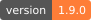

<p align="center">
  
</p>

<h1 align="center">ForgeMiner</h1>

<p align="center"><b>Быстрый нативный GPU-майнер для NVIDIA и AMD — Pearl (PRL), QubitCoin (QTC), KawPow (Ravencoin, Quai, Neurai), Cryptix (CYTX), BTX (btx.dev), Xelis (XEL), Conflux (CFX), NOID (Parano1d) и Quantus (QTC)</b></p>

<p align="center">
  <a href="https://github.com/0xHashRaptor/ForgeMiner/releases"></a>
  <a href="#загрузка"></a>
  <a href="#поддерживаемые-карты"></a>
</p>
<p align="center">
  <a href="https://forgeminer.org"></a>
  <a href="https://t.me/ForgeMiner"></a>
  <a href="https://discord.gg/CyU6ASQWSy"></a>
</p>

---

## Оглавление

- [Обзор](#обзор)
- [Загрузка](#загрузка)
- [Быстрый старт](#быстрый-старт)
- [Монеты и комиссия](#монеты-и-комиссия)
- [Возможности](#возможности)
- [Опции](#опции)
- [API мониторинга](#api-мониторинга)
- [Аппаратный разлок CMP (Linux)](#аппаратный-разлок-cmp-linux)
- [Поддерживаемые карты](#поддерживаемые-карты)
- [Ресурсы](#ресурсы)

---

## Обзор

ForgeMiner — высокопроизводительный, полностью нативный GPU-майнер для NVIDIA и AMD. С картами NVIDIA он работает напрямую через CUDA Driver API, с AMD Radeon — через OpenCL, без Python, WSL и лишних рантаймов, поэтому стартует мгновенно и легко идёт даже на слабых ригах. Майнит **Pearl (PRL)**, **QubitCoin (QTC)**, **KawPow** (Ravencoin RVN, Quai QUAI, Neurai XNA), **Cryptix (CYTX)**, **BTX (btx.dev)**, **Xelis (XEL)**, **Conflux (CFX)**, **NOID (Parano1d)** и **Quantus (QTC)** из одного бинарника — монета выбирается одним флагом — и новые монеты в разработке. Карты NVIDIA и AMD майнят вместе в одном риге.

Для каждого алгоритма есть отдельная сборка под архитектуру каждой карты — она выбирается автоматически при запуске, так каждая GPU работает на пике. Риги с CMP 40HX, 50HX, 70HX или 90HX получают встроенный аппаратный разлок на Linux одной командой, на любом ядре — см. [Аппаратный разлок CMP](#аппаратный-разлок-cmp-linux).

Сайт: **[forgeminer.org](https://forgeminer.org)** · ForgeMiner — closed-source; релизы публикуются здесь и анонсируются в [Telegram](https://t.me/ForgeMiner) и [Discord](https://discord.gg/CyU6ASQWSy).

<!-- Совет: вставьте сюда скриншот дашборда — это сразу повышает доверие, напр. -->
<!-- <p align="center"></p> -->

---

## Загрузка

Последняя сборка — на странице [**Releases**](https://github.com/0xHashRaptor/ForgeMiner/releases):

| Платформа | Пакет |
|---|---|
| Windows | `ForgeMiner-<версия>-windows.zip` |
| Linux | `ForgeMiner-<версия>-linux.tar.gz` (glibc 2.17+) |
| HiveOS | `ForgeMiner-<версия>.tar.gz` — URL установки в полётнике |
| Docker | `docker pull hashraptor/forge` (теги `:latest` и версия; только NVIDIA) |

---

## Быстрый старт

### Windows
1. Скачайте и распакуйте Windows-релиз.
2. Откройте `.bat` под свою монету/пул/регион и впишите кошелёк и воркер. На каждую монету — своя папка, всего 110 готовых запускаторов (`-SSL` = шифрованное соединение):
   - `Pearl (PRL)\` — 22: Kryptex, LuckyPool, HeroMiners, BaikalMine, 2Miners, AlphaPool
   - `Ravencoin (RVN)\` — 19 · `Quai (QUAI)\` — 14 · `Neurai (XNA)\` — 12
   - `Conflux (CFX)\` и `Xelis (XEL)\` — по 10
   - `Quantus (QTC)\` — 9 · `QubitCoin (QTC)\` — 6 · `NOID (Parano1d)\` — 5 · `Cryptix (CYTX)\` — 2 · `BTX\` — 1
3. Двойной клик — запуск. Для встроенного разгона — «Запуск от имени администратора». Для карт AMD — те же `.bat`.

### Linux
```bash
chmod +x forge
# Pearl
./forge --algorithm pearlhash --wallet YOUR_PRL_WALLET --pool prl.kryptex.network:7048 --worker rig01
# QubitCoin
./forge --algorithm qhash --wallet YOUR_QTC_WALLET --pool ru.luckypool.io:8610 --worker rig01
# KawPow — RVN / QUAI (монета определяется по пулу) или XNA (задать --coin xna)
./forge --algorithm kawpow --wallet YOUR_RVN_WALLET --pool rvn.kryptex.network:7031 --worker rig01
# Cryptix
./forge --algorithm cryptix --wallet YOUR_CYTX_WALLET --pool cytx.baikalmine.com:9010 --worker rig01
# BTX — btx-pool.com (LuckyPool больше не обслуживает BTX)
./forge --algorithm btx --wallet YOUR_BTX_WALLET --pool btx-pool.com:3334 --worker rig01
# Xelis
./forge --algorithm xelis --wallet YOUR_XEL_WALLET --pool xel.kryptex.network:7019 --worker rig01
# Conflux (нужно больше 8 ГБ видеопамяти, см. примечание под таблицей)
./forge --algorithm cfx --wallet YOUR_CFX_WALLET --pool cfx.kryptex.network:7027 --worker rig01
# Quantus (GTX 10-й серии и новее, включая Tesla V100, AMD RX 5000 и новее; кроме CMP 170HX. Не путать с QubitCoin — у него тот же тикер QTC)
./forge --algorithm quantus --wallet YOUR_QUANTUS_WALLET --pool qtc.kryptex.network:7049 --worker rig01
# NOID (GTX 10-й серии и новее, включая Tesla V100, AMD RX 5000 и новее; кроме CMP 170HX)
./forge --algorithm noid --wallet YOUR_NOID_WALLET --pool stratum+ssl://eu2.innovlab.cc:19601 --worker rig01
```

Linux-сборка собрана под **glibc 2.17**, поэтому работает начиная с CentOS 7 / Ubuntu 14.04 — не нужен ни CUDA toolkit, ни дополнительные библиотеки, только драйвер NVIDIA. Картам AMD нужны драйвер amdgpu и OpenCL от AMD (ROCm; в HiveOS есть оба), а майнер запускается от root или пользователем из группы `render`. Добавьте `--api-bind 0.0.0.0:7777` к любой команде выше и откройте `http://<rig>:7777` — это встроенный дашборд.

### Docker
```bash
docker pull hashraptor/forge
docker run --rm --gpus all hashraptor/forge \
  --algorithm pearlhash --wallet YOUR_PRL_WALLET --worker rig01 --pool prl.kryptex.network:7048
# дашборд: добавьте -p 7777:7777 и --api-bind 0.0.0.0:7777
```
Образ Docker — для карт NVIDIA.

### HiveOS
ForgeMiner есть и во встроенном списке майнеров HiveOS; новые версии появляются там, когда HiveOS их упакует. Чтобы получать каждый релиз в день выхода, используйте кастомный майнер — URL установки `https://github.com/0xHashRaptor/ForgeMiner/releases/download/v<версия>/ForgeMiner-<версия>.tar.gz` (например `v1.8.5/ForgeMiner-1.8.5.tar.gz`), шаблон кошелька `%WAL%.%WORKER_NAME%`.

**Для обновления поменяйте версию в этом URL** (в двух местах) и обновите полётник — все риги на нём переустановятся. HiveOS ставит кастомный майнер один раз на каждый URL: если URL не поменялся, он пишет *Already installed* и оставляет старую версию. Риги, настроенные по старой ссылке `.../releases/latest/download/ForgeMiner.tar.gz`, так и остаются на той версии, что поставилась первой; переведите их на версионный URL или выполните на риге `custom-get https://github.com/0xHashRaptor/ForgeMiner/releases/latest/download/ForgeMiner.tar.gz -f` и перезапустите майнер.

*Extra config* принимает **обе** формы, по одной в строке, и их можно смешивать:

```
FORGE_ALGO=xelis            # или pearlhash / qhash / kawpow / cryptix / btx / cfx / noid / quantus
FORGE_COIN=xna              # только для KawPow: rvn | quai | xna
--gpu 0,1,3                 # майнить только эти карты
FORGE_AMD=1                 # только карты AMD (FORGE_AMD=0: только NVIDIA)
--cclk 1500 --moff 1000     # разгон: также --coff / --mclk / --plimit
--vddoff -50                # смещение напряжения ядра AMD, мВ (также --vddc)
--fan 70                    # или --fan-curve 45:30,60:55,70:75,80:100
--proxy socks5://host:port  # все соединения с пулами через прокси
--cmp-install               # разлочить CMP 40HX/50HX/70HX/90HX на риге (безопасно оставлять навсегда)
--temp-limit 80 --temp-resume 70   # пауза карты при перегреве, возобновление после остывания
```

Хешрейт, температуры и шары появятся в панели HiveOS сами — отдельный флаг не нужен. `--api-bind 0.0.0.0:7777` добавляйте только если хотите ещё и собственный веб-дашборд майнера.

Готовые полётники: **[forgeminer.org/#flightsheets](https://forgeminer.org/#flightsheets)**.

---

## Монеты и комиссия

| Монета | `--algorithm` | Пулы (готовые `.bat` в релизе) | Комиссия |
|--------|---------------|--------------------------------|:------:|
| NOID (Parano1d) | `noid` | InnovLab · LuckyPool · Suprnova | 2.5% |
| Pearl (PRL) | `pearlhash` | Kryptex · BaikalMine · HeroMiners · LuckyPool · 2Miners · AlphaPool | 2% |
| Cryptix (CYTX) | `cryptix` | BaikalMine · CryptixNetwork | 2% |
| BTX (btx.dev) | `btx` | LuckyPool (lproute) | 2% |
| Quantus (QTC) | `quantus` | Kryptex · LuckyPool | 2% |
| Conflux (CFX) | `cfx` | Kryptex · HeroMiners | 1.5% |
| QubitCoin (QTC) | `qhash` | LuckyPool · k1pool | 1% |
| Xelis (XEL) | `xelis` | Kryptex · HeroMiners | 1% |
| Ravencoin (RVN) | `kawpow` | Kryptex · HeroMiners · 2Miners · RavenMiner · k1pool | 0.7% |
| Quai (QUAI) | `kawpow` `--coin quai` | Kryptex · HeroMiners · k1pool | 0.7% |
| Neurai (XNA) | `kawpow` `--coin xna` | Kryptex · 2Miners · Vipor | 0.7% |

Conflux требует около **9.4 ГБ видеопамяти** (набор данных 8.7 ГиБ), и это требование медленно растёт вместе с сетью:
карты на 8 ГБ монету не потянут, на 10 ГБ впритык, от 11 ГБ спокойно. Майнер проверяет карту на
старте и говорит об этом с реальными числами, а не падает посреди подготовки.

NOID работает начиная с GTX 10-й серии (Pascal), включая Tesla V100, и на AMD RX 5000 и новее. CMP 170HX
простаивает и один раз об этом пишет, остальные карты рига майнят.

Комиссия чередуется в потоке (без провалов на графике) и проверяется на пуле. Скрытой второй комиссии нет. *Больше алгоритмов в разработке.*

---

## Возможности

- **Много монет, один бинарь** — Pearl, QubitCoin, KawPow (RVN / QUAI / XNA), Cryptix, BTX, Xelis, Conflux, NOID или Quantus; выбор через `--algorithm`.
- **Ядра под архитектуру** — отдельное ядро под каждое поколение (Pascal / Volta / Turing / Ampere / Ada / Blackwell, AMD RDNA 1–4), выбирается при старте.
- **NVIDIA и AMD в одном риге** — Radeon RX 5000 / 6000 / 7000 / 9000 майнят все монеты, кроме BTX, с теми же командными строками, на Linux / HiveOS и Windows. Смешанный риг работает в одном ForgeMiner: сначала нумеруются карты NVIDIA, потом AMD.
- **Аппаратный разлок CMP 40HX / 50HX / 70HX / 90HX (Linux)** — одна встроенная команда разлочивает любую из этих карт со стокового задушенного хешрейта до полной скорости; никаких сторонних скриптов и точного совпадения ядра (драйвер 610.43.03 по-прежнему нужен).
- **Нативно и легко** — напрямую через CUDA Driver API на NVIDIA и OpenCL на AMD, почти нулевая нагрузка на CPU; без Python, WSL и рантаймов. Стартует за секунду, идёт на слабых хостах и многокарточных ригах.
- **Эффективно на забитых ригах** — держит карты загруженными даже при слабом CPU, нескольких инстансах или медленных x1-райзерах.
- **Один самодостаточный бинарь** — всё внутри; без CUDA runtime и разбросанных файлов ядер. Даже KawPow — один исполняемый файл.
- **Встроенный разгон и кулеры** — фикс частот, оффсеты, лимит мощности и управление кулерами прямо из майнера — свой разгон на каждую карту, а на AMD ещё и напряжение ядра. Без сторонних утилит.
- **Термозащита** — `--temp-limit` / `--temp-resume` сами ставят карту на паузу при перегреве и возобновляют майнинг после остывания.
- **Multi-pool с failover** — обычный Stratum для всех монет. Шифрованный пул определяется сам, поэтому обычного `host:port` достаточно независимо от того, работает пул по TLS или нет; перечислите несколько адресов через запятую, и майнер перейдёт на следующий, когда пул отвалится. `--proxy` пускает все соединения через SOCKS5 или HTTP.
- **Живой дашборд и API только для чтения** — таблица по картам закреплена сверху, лог прокручивается под ней (клавиша `L` — классический вид). Хешрейт по картам, температуры (в т.ч. VRAM на Windows), частоты, кулеры, мощность и шары, плюс показатель доставки — какую долю хешрейта пул реально засчитывает, — и эндпоинты JSON, Prometheus и Claymore-совместимый.
- **Готов к HiveOS** — вставляется в слот кастомного майнера.

---

## Опции

У большинства флагов командной строки есть двойник-переменная `FORGE_*` — удобно для *Extra config* в HiveOS и `.bat`.

| Флаг | Env | Описание |
|------|-----|----------|
| `--algorithm` | `FORGE_ALGO` | `pearlhash`, `qhash`, `kawpow`, `cryptix`, `btx`, `xelis`, `cfx`, `noid` или `quantus` (`qhash` — QubitCoin, `quantus` — Quantus: у обеих тикер QTC). |
| `--coin` | `FORGE_COIN` | Монета KawPow: `rvn`, `quai` или `xna` (определяется по пулу; для Neurai / Vipor задавать явно). |
| `--pool` | `FORGE_POOL` | Пул `host:port`. TLS определяется автоматически — префикс `ssl://` нужен только чтобы навязать его. Несколько адресов через запятую для failover. |
| `--wallet` | `FORGE_WALLET` | Адрес кошелька для выплат. |
| `--worker` | `FORGE_WORKER` | Имя воркера/рига. |
| `--password` | `FORGE_PASS` | Пароль пула (обычно `x`). |
| `--gpu` | `FORGE_GPU` | Майнить только эти индексы, напр. `0,1,2,6` (сначала NVIDIA в порядке `nvidia-smi`, потом AMD по порядку шины PCI). |
| — | `FORGE_AMD` | `1` — майнить только на картах AMD, `0` — только на NVIDIA. По умолчанию на всех. |
| `--proxy` | `FORGE_PROXY` | Все соединения с пулами — включая резервные и комиссию — через прокси: `socks5://[user:pass@]host:port` (имена пулов разрешает прокси) или `http://[user:pass@]host:port` (CONNECT). |
| `--temp-limit` | `FORGE_TEMP_LIMIT` | Автопауза карты при достижении этой температуры (°C). |
| `--temp-resume` | `FORGE_TEMP_RESUME` | Возобновить карту после остывания до этой температуры (°C). |
| `--oc-delay` | `FORGE_OC_DELAY` | Отложить применение разгона на N секунд после старта. |
| `--tls` | `FORGE_TLS` | Включить (`--tls`) или выключить (`--tls false`) TLS на всех пулах. Обычно не нужно — TLS определяется сам; префикс `ssl://` у отдельного адреса важнее этого флага. |
| `--no-color` / `--plain` | `FORGE_NO_COLOR` (или `NO_COLOR`) | Вывод только ASCII, без цвета; включается сам, когда консоли нет (PSEXEC, конвейер, cron). |
| `--log` | `FORGE_LOG` | Сохранять вывод в файл (вместе с таблицами, без цветовых кодов). По умолчанию выключено, пишет в конец. |
| `--v1-tui` | — | Запуститься в классическом прокручивающемся виде вместо закреплённой панели. Клавиша `L` переключает в любой момент. |
| `--cmp-install` | — | Linux: поставить аппаратный разлок для CMP 40HX / 50HX / 70HX / 90HX (см. [ниже](#аппаратный-разлок-cmp-linux)). |
| `--cmp-verify` | — | Linux: показать живой статус разлока по CMP-картам. |
| `--cmp-rollback` | — | Linux: откатить разлок, вернуть прежний драйвер. |
| — | `FORGE_LOWVRAM` | Режим low-VRAM для 8 ГБ карт (Pearl). По умолчанию авто. |

<details>
<summary><b>Разгон и управление кулерами</b></summary>

> ForgeMiner упирается в частоту ядра и нетребователен к памяти — поднимайте ядро, память можно оставить низкой. Разгон требует root (Linux/HiveOS) или Администратора (Windows). Каждый флаг принимает одно значение или список через запятую под `--gpu`. `*` в списке — не трогать эту карту.

| Флаг | Env | Описание |
|------|-----|----------|
| `--cclk` | `FORGE_CCLK` | Зафиксировать частоту ядра (МГц). |
| `--coff` | `FORGE_COFF` | Оффсет ядра (МГц, +/−). |
| `--mclk` | `FORGE_MCLK` | Зафиксировать частоту памяти (МГц). На GTX 10 / RTX 20 `810` держит память на 810 МГц — Quantus и NOID сохраняют хешрейт при меньшей мощности. |
| `--moff` | `FORGE_MOFF` | Оффсет памяти (МГц, +/−). |
| `--plimit` | `FORGE_PLIMIT` | Лимит мощности (Вт; на Windows с AMD — процент от лимита карты). |
| `--vddoff` | — | AMD: смещение напряжения ядра (мВ, со знаком; RX 6000 / 7000 / 9000; псевдоним `--vo`). |
| `--vddc` | — | AMD: напряжение ядра (мВ; RX 5000 / 6000; псевдоним `--vcore`). RX 7000 / 9000 принимают только смещение. |
| `--fan` | `FORGE_FAN` | Фиксированная скорость кулера (%). |
| `--fan-curve` | `FORGE_FANCURVE` | Кривая температура→скорость, напр. `45:30,60:55,70:75,80:100` (NVIDIA; на AMD — `--fan`). |
| `--oc-keep` | `FORGE_OC_KEEP=1` | Оставить разгон на картах после выхода майнера. |
| `--oc-reset` | — | Вернуть карты в сток (штатный лимит мощности, без фиксации частот, оффсеты 0) и выйти — после падения или жёсткого убийства процесса. С `--gpu` — только эти карты. |

```text
# по-картово (значения по порядку --gpu)
--gpu 0,1,2,6 --coff 300,250,300,200 --plimit 280,280,300,260

# * = не трогать карту: GPU 2 остаётся на своих частотах и авто-кулере
--gpu 0,1,2,6 --cclk 1500,1500,*,1500 --fan 70,70,*,70
```
У GeForce есть аппаратный порог кулера ~30%; при выходе возвращается авто-режим драйвера. Частоты, напряжение, лимит мощности и кулеры AMD при выходе тоже возвращаются (`--oc-keep` оставляет разгон).
</details>

---

## API мониторинга

Выключен по умолчанию и **только для чтения** — отдаёт статистику, управлять майнером через него нельзя.

```text
--api                    на 127.0.0.1:7777 (только эта машина)
--api-bind 0.0.0.0:7777  в локальной сети (смотреть с телефона / другого ПК)
```
На HiveOS задайте `FORGE_API=127.0.0.1:7777` в *Extra config*.

| Эндпоинт | Формат | Для чего |
|---|---|---|
| `GET /` | HTML | Веб-дашборд (общий и по-картовый хешрейт, температуры, VRAM, частоты, кулеры, мощность, шары, живой график; тёмная/светлая тема). |
| `GET /summary` | JSON | Grafana, боты, свои дашборды. |
| `GET /metrics` | Prometheus | Дашборды и алерты Grafana. |
| `miner_getstat1` | Claymore | Awesome Miner и остальная экосистема мониторинга. |

> Оставляйте `127.0.0.1` для локального доступа; `0.0.0.0` — только за своим роутером / файрволом / VPN.

---

## Аппаратный разлок CMP (Linux)

CMP 40HX, 50HX, 70HX и 90HX с завода задушены аппаратно — стоковый хешрейт составляет лишь малую долю того, на что способен чип. Форж умеет поставить хелпер разлока прямо на риге — одна команда, одна перезагрузка, карта работает на полной скорости. Хелпер встроен в бинарь; ничего внешнего скачивать не нужно.

Собирается из исходников под то ядро, что реально стоит на риге — точное совпадение ядра больше не нужно (драйвер NVIDIA 610.43.03 по-прежнему обязателен), протестировано без единого сбоя на 10 разных версиях ядра. Затрагивает только обнаруженные CMP-карты; остальные GPU в смешанном риге работают без изменений. CMP 30HX обнаруживается, но никогда не трогается — это постоянное аппаратное ограничение этого чипа, не баг и не недоработка.

| Команда | Что делает |
|---|---|
| `sudo forge --cmp-install` | ставит хелпер разлока, перезагружает риг (10 сек на отмену) |
| `sudo forge --cmp-install --no-reboot` | только установка, ребут делаете сами |
| `sudo forge --cmp-verify` | живой статус разлока по CMP-картам |
| `sudo forge --cmp-rollback` | вернуть прежний драйвер из бэкапа, ребут |

Можно спокойно оставить `--cmp-install` в конце строки запуска полётника навсегда — если разлок уже стоит, форж напечатает одну строку и сразу идёт майнить; на риге без CMP-карт (полётник, общий с другими ригами) он напечатает одну строку и майнит как обычно. Полная инструкция (проверка, FAQ): **[wiki · CMP аппаратный разлок](https://github.com/0xHashRaptor/ForgeMiner/wiki/CMP-unlock-RU)**.

---

## Поддерживаемые карты

Ядра затюнены под архитектуру, поэтому поддерживается всё поколение целиком — десктопные и ноутбучные.

| Поколение | Карты |
|---|---|
| **Blackwell** (RTX 50) | 5090 · 5080 · 5070 Ti · 5070 · 5060 Ti · 5060 · 50-й серии Laptop *(драйвер 580+)* |
| **Ada** (RTX 40) | 4090 · 4080 (S) · 4070 Ti (S) · 4070 (S) · 4060 Ti · 4060 · 40-й серии Laptop |
| **Ampere** (RTX 30) | 3090 Ti · 3090 · 3080 Ti · 3080 · 3070 Ti · 3070 · 3060 Ti · 3060 · 30-й серии Laptop |
| **Turing** (RTX 20) | 2080 Ti · 2080 (S) · 2070 (S) · 2060 (S) · 20-й серии Laptop *(драйвер 545+)* |
| **Volta** | Tesla V100 |
| **Pascal** | GTX 10-й серии · P104-100 · P106 · P108 (8 ГБ майнинг-карты) |
| **CMP** | 170HX · 90HX · 70HX · 50HX · 40HX · 30HX *(драйвер 545+)*. 40HX/50HX/70HX/90HX получают встроенный [аппаратный разлок](#аппаратный-разлок-cmp-linux) на Linux; 30HX — постоянное аппаратное ограничение, никогда не будет поддержана; 170HX нужен отдельный инструмент. |
| **AMD RDNA 4** (RX 9000) | 9070 XT · 9070 · 9060 XT *(свежий драйвер; на HiveOS свежий образ)* |
| **AMD RDNA 3** (RX 7000) | 7900 XTX · 7900 XT · 7900 GRE · 7800 XT · 7700 XT · 7600 XT · 7600 |
| **AMD RDNA 2** (RX 6000) | 6950 XT · 6900 XT · 6800 XT · 6800 · 6750 XT · 6700 XT · 6700 · 6650 XT · 6600 XT · 6600 |
| **AMD RDNA 1** (RX 5000) | 5700 XT · 5700 · 5600 XT · 5500 XT |

*Все монеты работают на каждом из перечисленных поколений, с такими исключениями: **BTX** нужен Volta (Tesla V100) или Turing (RTX 20 / CMP 40HX-70HX) и новее, на Pascal и CMP 170HX он не идёт; **Conflux** работает начиная с Pascal на картах с памятью больше 8 ГБ (GTX 1080 Ti, Tesla V100, RTX 20 и новее), кроме CMP 170HX; **Quantus**, **NOID** и **QubitCoin** работают начиная с Pascal (GTX 10), включая Tesla V100, но не на CMP 170HX. На **AMD** идут все монеты, кроме **BTX**; Conflux и там требует больше 8 ГБ; RX 6500 XT / 6400 и встроенная графика Radeon не поддерживаются. Карта, для которой у выбранной монеты нет ядра, скажет об этом одной строкой, остальные карты продолжат майнить.*

---

## Ресурсы

- **Сайт:** [forgeminer.org](https://forgeminer.org)
- **Релизы и новости:** [t.me/ForgeMiner](https://t.me/ForgeMiner)
- **Поддержка и чат:** [t.me/ForgeMinerChat](https://t.me/ForgeMinerChat)
- **Discord:** [discord.gg/CyU6ASQWSy](https://discord.gg/CyU6ASQWSy)
- **Инструкция по CMP-разлоку:** [wiki · CMP аппаратный разлок](https://github.com/0xHashRaptor/ForgeMiner/wiki/CMP-unlock-RU)

---

<p align="center"><sub>© 2026 ForgeMiner. Не связан с NVIDIA и AMD. Майньте ответственно.</sub></p>
